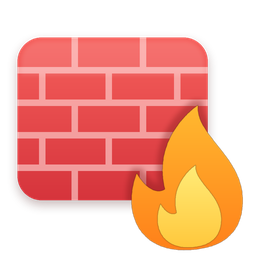
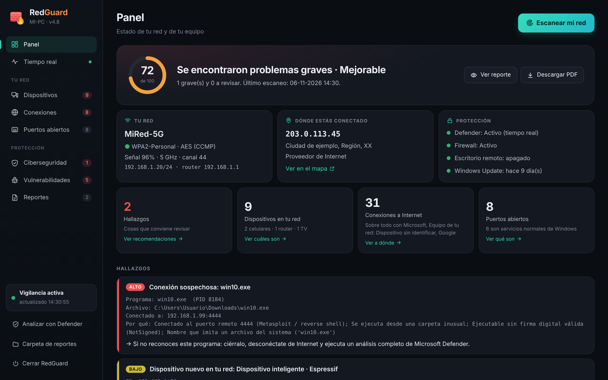
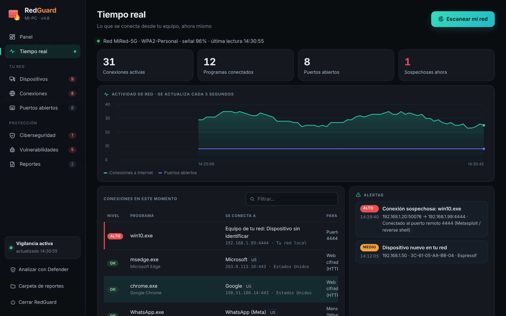
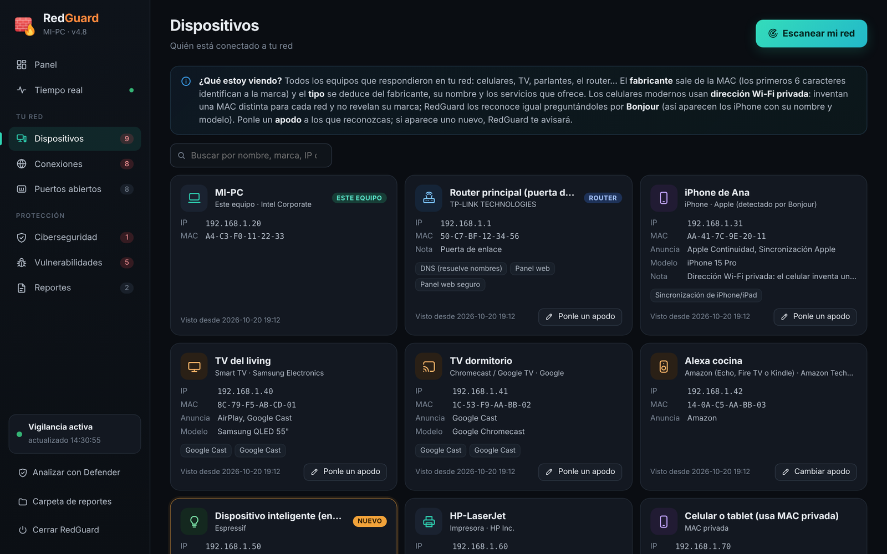
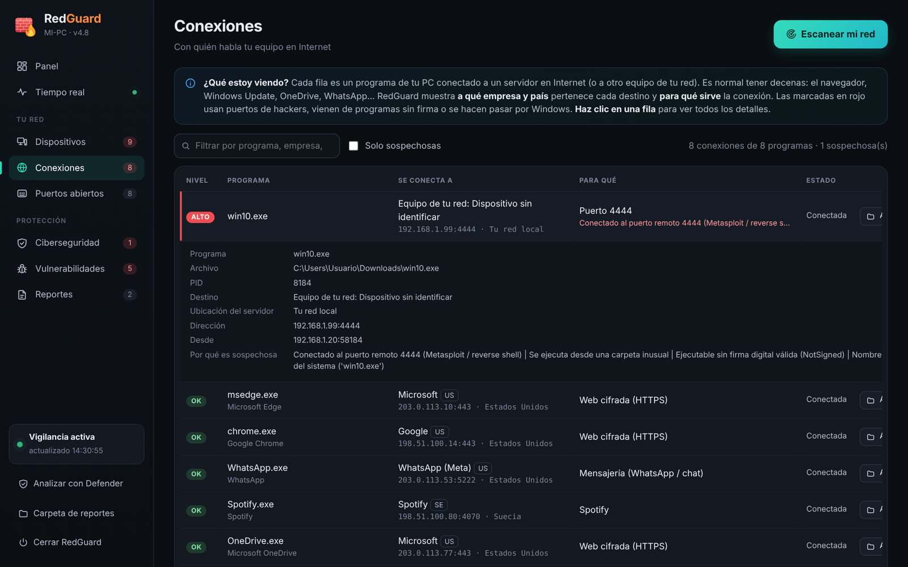
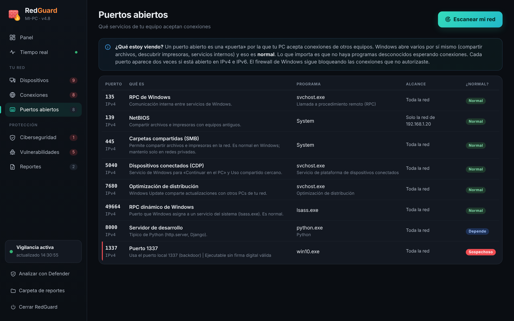
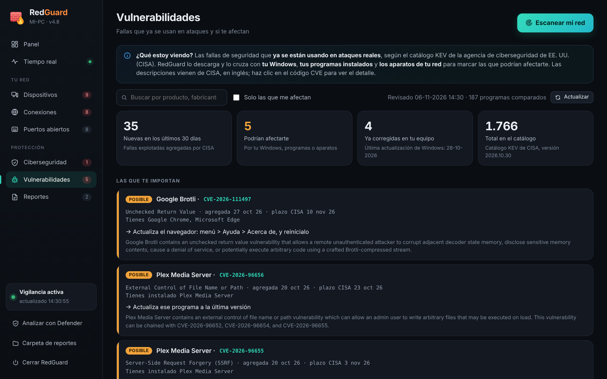
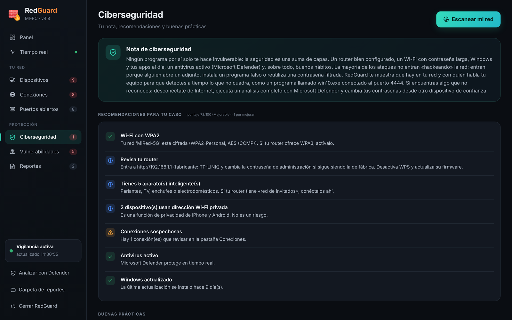

<p align="center">
  
</p>

<h1 align="center">RedGuard</h1>

<p align="center"><b>Guardián de red para Windows</b>: descubre quién está conectado a tu red, con quién habla tu PC y si hay algo sospechoso.<br>
Sin instalar nada extra: funciona con PowerShell y Microsoft Edge, que ya vienen en Windows.</p>

<p align="center"></p>

> Todas las imágenes usan una red de ejemplo inventada (direcciones de documentación como `203.0.113.45` y equipos ficticios).

---

## Qué hace

| Sección | Qué revisa |
| --- | --- |
| **Panel** | Puntaje de seguridad de 0 a 100, tu red Wi‑Fi (nombre, cifrado, señal), tu IP pública y ubicación aproximada, estado de Defender, firewall, escritorio remoto y Windows Update. |
| **Tiempo real** | Vigila cada 5 segundos las conexiones de tu PC. Muestra un gráfico de actividad y avisa con una notificación de Windows si aparece algo sospechoso o un dispositivo nuevo, aunque la ventana esté cerrada. |
| **Dispositivos** | Encuentra los equipos de tu red y deduce qué son: celulares, TV, parlantes, impresoras, aparatos inteligentes, el router… Usa el fabricante de la MAC (base oficial del IEEE incluida), Bonjour/mDNS, UPnP, NetBIOS y los servicios que ofrece cada uno. Puedes ponerles apodos. |
| **Conexiones** | Qué programa se conecta a dónde: la empresa y el país del destino (Google, Microsoft, WhatsApp…) y para qué sirve la conexión. |
| **Puertos abiertos** | Qué servicios de tu PC aceptan conexiones, qué es cada uno y si es normal en Windows. |
| **Vulnerabilidades** | Descarga el catálogo **KEV de CISA** (fallas que ya se usan en ataques reales) y lo cruza con tu Windows, tus programas instalados y los aparatos de tu red. |
| **Ciberseguridad** | Recomendaciones según lo que encontró y buenas prácticas. |
| **Reportes** | Cada escaneo se guarda en **HTML y PDF**. |

### Qué considera sospechoso

- Conexiones a puertos típicos de *reverse shells*, backdoors, botnets o minería (4444, 1337, 31337, 6667, 3333…).
- Programas que se hacen pasar por archivos de Windows (`svch0st.exe`, `win10.exe`) o que corren fuera de `C:\Windows` con un nombre del sistema.
- Ejecutables **sin firma digital** que se ejecutan desde Descargas, Temp u otras carpetas inusuales.
- Consolas e intérpretes (`cmd`, `powershell`, `mshta`, `nc`…) con conexiones abiertas a Internet.
- Software de control remoto aceptando conexiones (RDP, VNC, TeamViewer, AnyDesk).
- Wi‑Fi abierta o con cifrado débil, posible suplantación del router (*ARP spoofing*), proxy configurado, archivo `hosts` modificado, Defender o firewall apagados.
- Aparatos de tu red con Telnet o depuración de Android (ADB) expuestos.

## Capturas

| Tiempo real | Dispositivos |
| --- | --- |
|  |  |
| **Conexiones** | **Puertos abiertos** |
|  |  |
| **Vulnerabilidades** | **Ciberseguridad** |
|  |  |

## Instalación

1. Descarga esta carpeta (**Code → Download ZIP**) y descomprímela (clic derecho → *Extraer todo*).
2. Entra en la carpeta `RedGuard` y haz doble clic en **`Instalar.bat`**.
   Si Windows muestra *«Windows protegió su PC»*: **Más información → Ejecutar de todas formas**.
3. El instalador copia RedGuard a `Documentos\RedGuard`, crea el acceso directo **RedGuard** en el escritorio y lo abre. El primer escaneo empieza solo.

**Requisitos:** Windows 10 u 11 (Intel, AMD o ARM) y Microsoft Edge. No necesita Python, Java ni permisos de administrador. Si lo ejecutas como administrador verá también las rutas de los servicios del sistema.

Para **actualizar**, vuelve a ejecutar `Instalar.bat` con la versión nueva: se conservan tus reportes, apodos e historial. Si RedGuard está abierto, se reinicia solo con la versión nueva.

Para **desinstalar**: clic derecho en el ícono de RedGuard junto al reloj → *Cerrar RedGuard*, y borra `Documentos\RedGuard` y el acceso directo.

## Cómo funciona

```
Documentos\RedGuard\
├─ RedGuard-Web.ps1   servidor local + ícono junto al reloj (abre la ventana en Edge)
├─ RedGuard.ps1       motor: escaneo, vigilancia en tiempo real, vulnerabilidades y reportes
├─ ui\index.html      interfaz HTML5
├─ datos\             base de fabricantes (oui.tsv), resultados y diagnóstico
└─ Reportes\          reportes HTML y PDF de cada escaneo
```

- La interfaz se sirve **solo dentro de tu PC** (`127.0.0.1`) con una clave aleatoria que cambia en cada inicio, así que ninguna página web externa puede controlarla.
- El escaneo y la vigilancia corren en procesos separados; cada escaneo deja `datos\diagnostico.txt` para encontrar errores.
- También puedes usar el modo consola: `app\RedGuard-Consola.bat`.

## Privacidad

RedGuard no envía tus archivos, nombres de programas ni tu tráfico a ninguna parte. Para dar más detalle consulta:

| Servicio | Qué se envía | Para qué |
| --- | --- | --- |
| ipinfo.io / ip-api.com | Tu IP pública y las IP públicas de los servidores a los que se conecta tu PC | Ubicación aproximada, empresa y país de cada destino |
| macvendors.com / maclookup.app | Solo el prefijo de fabricante (6 caracteres) de MAC que no están en la base local | Saber la marca de un dispositivo |
| CISA (cisa.gov / GitHub) | Nada; solo descarga el catálogo | Lista de vulnerabilidades explotadas |

## Uso responsable

- Usa RedGuard **solo en redes que sean tuyas o donde tengas permiso**: para identificar dispositivos prueba algunos puertos de los equipos de la red, y en una red ajena eso puede considerarse un escaneo.
- RedGuard **complementa** a Microsoft Defender; no lo reemplaza ni analiza archivos en busca de virus.
- Una coincidencia en *Vulnerabilidades* significa «revísalo», no «estás infectado».

## Créditos

- Fabricantes por MAC: registro público [IEEE OUI](https://standards-oui.ieee.org/) y la lista `manuf` de [Wireshark](https://www.wireshark.org/).
- Vulnerabilidades explotadas: [catálogo KEV de CISA](https://www.cisa.gov/known-exploited-vulnerabilities-catalog).
